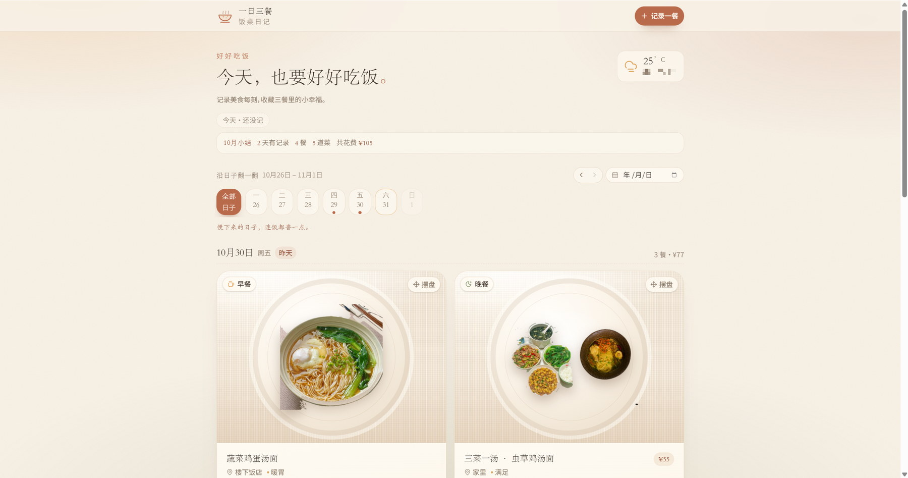
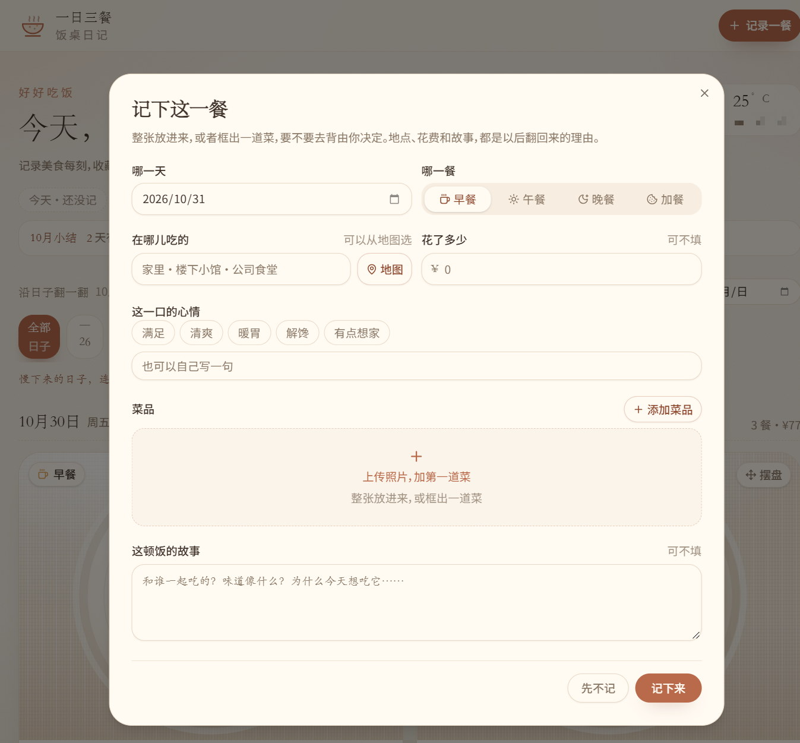
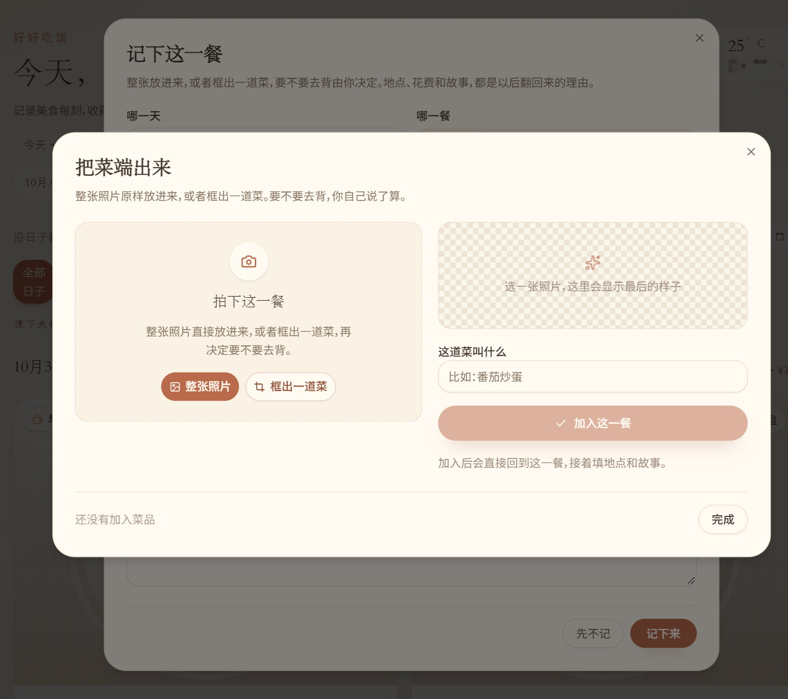
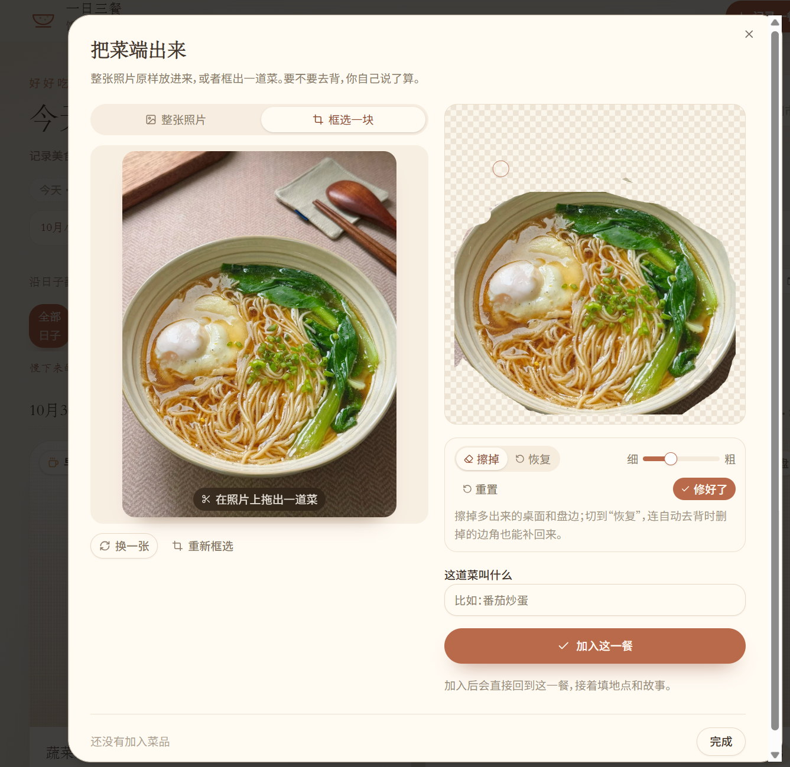

# 一日三餐 · 饭桌日记

> 记录美食每刻，收藏三餐里的小幸福。

一个只属于你自己的饭桌日记。拍下每一餐，自动隐去桌面和盘子的背景，把菜摆进盘子里，再记下地点、花费和那顿饭的故事。纯前端项目，记录只保存在当前浏览器里，不需要账号，也没有服务器。



## 功能

- **拍照 + 自动抠图**：整张照片原样放入，或者框出一道菜再决定要不要去背；抠完还能用画笔擦掉多余的桌面和盘边，切到「恢复」可以把自动去背时删掉的边角补回来。
- **按周翻页的日子条**：一周七天一目了然，每一天都有自己的一句暖心话，相邻两周不重样。
- **当天的记录与当月小结**：顶部跟着选中的日期显示「今天 · 已记 N 餐 / N 道菜 / 共花费」，下面一行汇总该月有记录的天数、餐数、菜数和花销。
- **从地图选就餐地点**：搜索店名或查看附近餐馆，选中只留下地点名字（也可以完全手写）。
- **天气卡片**：定位后显示城市、气温和天气。
- **摆盘**：把菜拖进盘子里，位置、大小和角度都会存下来。
- **数据留在本机**：全部存在浏览器 IndexedDB 里，没有上传，没有账号。

<table>
  <tr>
    <td width="50%"></td>
    <td width="50%"></td>
  </tr>
  <tr>
    <td align="center">记下日期、地点、花费和故事</td>
    <td align="center">整张放入或框出一道菜</td>
  </tr>
</table>



## 快速开始

需要 Node.js `^22.13.0` 或 `>=24.0.0`。

```bash
npm ci
cp .env.example .env     # Windows 用：copy .env.example .env
# 打开 .env，填入自己的 VITE_AMAP_KEY（见下节）
npm run dev
```

构建静态文件：

```bash
npm run build            # 产物在 dist/
npm run preview          # 本地预览 dist/
```

## 地图和天气 Key（需要自己申请）

天气、地点搜索和「附近」都使用[高德开放平台](https://console.amap.com/dev/key/app)的 REST 接口，Key 需要自己申请：

1. 登录高德开放平台，进入「应用管理 → 我的应用 → 创建新应用」。
2. 在应用下「添加 Key」，**服务平台选择「Web服务」**（本项目调用的是 REST API，不是 JS API）。
3. 复制 Key，填进根目录的 `.env`：

```bash
VITE_AMAP_KEY=你的Key
```

说明：

- 不填 Key 也能完整运行：天气会自动退回免 Key 的 Open-Meteo，「地图」按钮隐藏，地点手动填写即可。
- Key 会被打包进前端静态文件，无法真正保密，请在高德控制台为它设置用量上限或访问限制。
- `.env` 已列入 `.gitignore`，不要把真实的 Key 提交到仓库。

## 数据存放在哪里

所有记录和菜品图片都保存在浏览器 IndexedDB（数据库名 `warm-table-diary`）中。换浏览器、换设备或清理站点数据后会丢失，项目本身不提供云端同步。

## 技术栈

React 19 · TypeScript · Vite · Tailwind CSS 4 · Radix UI · lucide-react · sonner

抠图完全在浏览器里完成（`lib/cutout.ts`）：边缘颜色采样 + 色相门限的洪泛分割、盘子平面识别、边缘羽化与自动裁边，最终导出透明 PNG。

## 目录结构

```
components/   界面组件：日期条、记录编辑器、菜品上传与修边画板、地点选择…
lib/          抠图算法、IndexedDB、日期工具、天气与地点接口
src/          App 入口与全局样式
docs/         README 使用的截图
functions/    Qoder Sites 的可选边缘函数示例（本项目未使用）
```

## 说明

- 界面、配色和文案属于个人项目；工程骨架来自 Qoder Sites 的 React starter，出处见 [PROVENANCE.md](PROVENANCE.md)。
- 仓库不包含任何用户数据、照片或 API Key。
